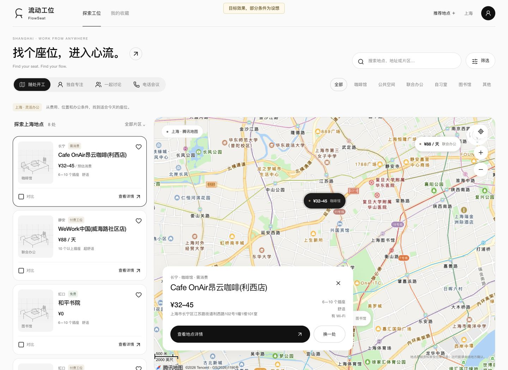
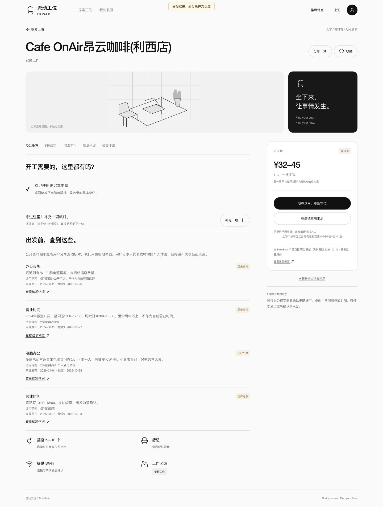
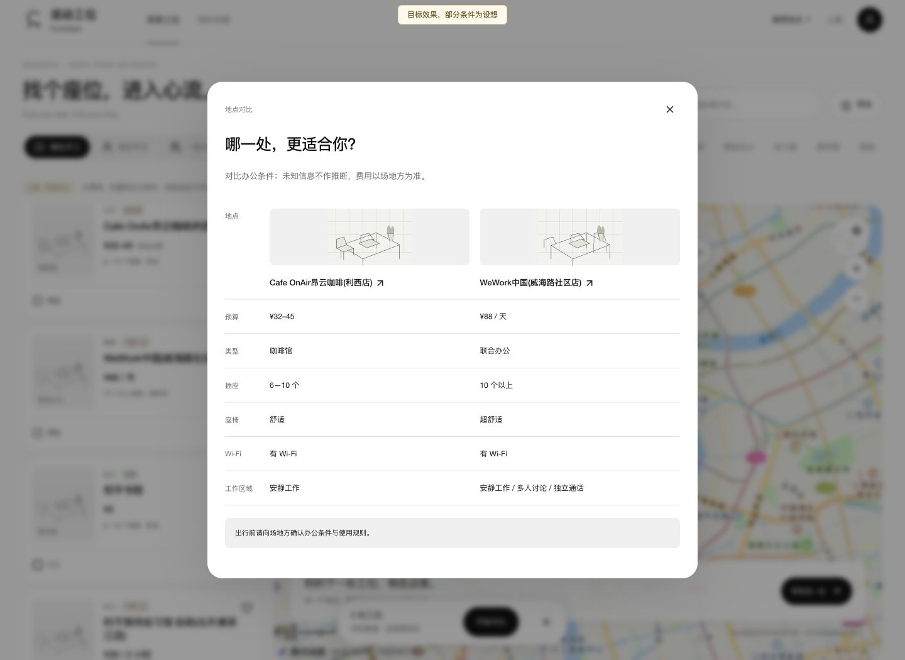
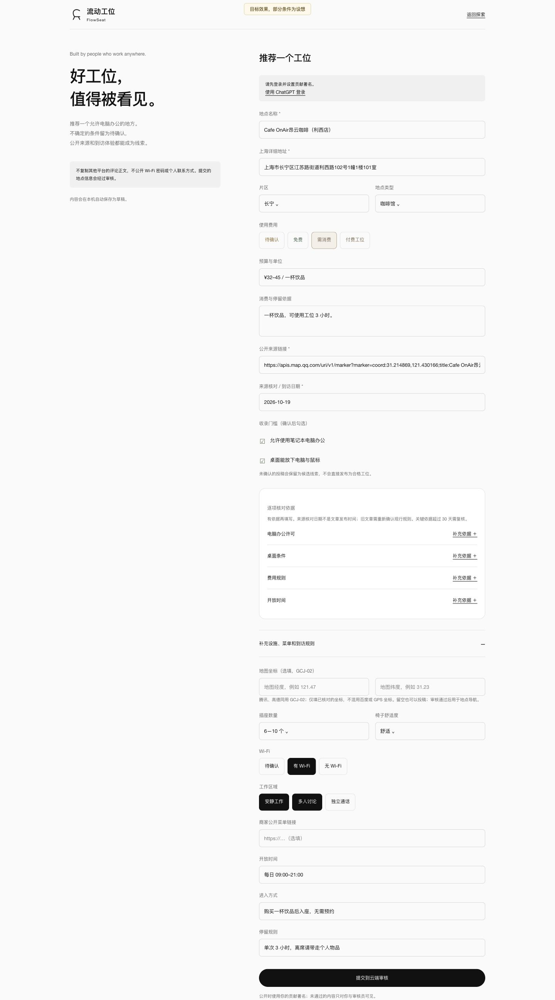

# 流动工位 · FlowSeat

### 城市很大，找到一个能安心工作的座位。

**带上电脑，换个地方进入心流。**

咖啡馆、图书馆、公共空间、联合办公——地点不难找，难的是知道：**能不能用电脑？有没有插座？坐一下午要花多少钱？适合安静写作，还是开一场电话会议？**

FlowSeat 是一张为自由职业者、远程工作者和独立创造者准备的城市办公地图。从上海出发，把位置、费用和办公条件放在一起，让你少翻几篇攻略，早一点坐下来，把想做的事做完。

*Find your seat. Find your flow.*

[看产品全貌](#从想出门到安心开工) · [看使用场景](#今天你想在哪里开工) · [了解进展](#一起把这张地图做得更好) · [本地运行](#本地开发)



> 产品目标效果：以下为实际 Web 页面截图，使用真实地点基础资料，部分办公条件为设想。空间插画为示意；具体费用与规则以场地方信息为准。

## 今天，你想在哪里开工？

| 你的计划 | FlowSeat 帮你做的选择 |
| --- | --- |
| 带电脑出门，专注写一个下午 | 从「独自专注」开始，看看桌椅、插座、Wi-Fi 和停留规则 |
| 和伙伴碰一下项目 | 找适合「一起讨论」的空间，提前了解费用和进入方式 |
| 中途还有一场线上会议 | 按「电话会议」找工作分区，查看是否有独立电话间 |
| 今天想少花一点 | 区分免费、需消费和付费工位，再比较预算与条件 |
| 发现一个以后还想来的地方 | 收藏进自己的常用地点清单，下次少做一次功课 |

## 不只找到地点，还要知道能不能好好工作

**按工作方式选，而不只是按店铺类型选。** 独自专注、一起讨论、电话会议，先选今天要做什么，再找适合的空间。咖啡馆、公共空间和联合办公放在同一张地图里比较。

**把出发前最关心的事放在一起。** 费用、开放时间、进入方式、电脑使用规则、桌面、座椅、插座、Wi-Fi 和工作分区，不用在地图、攻略和评论区之间来回找。

**让选择有依据，也有备选。** 地图与列表联动，密集地点聚类；收藏感兴趣的地点，最多同时对比 3 处。位置合适但条件不合适，就换下一处。

**一张可以一起维护的地图。** 发现新地点可以推荐，到了现场可以补充一项信息、记录体验、反馈空位或纠错。资料保留来源与日期，新地点、体验和单项补充经过审核，让下一位带电脑出门的人少踩一个坑。

## 从想出门，到安心开工

### 01 · 先找到今天想去的地方

打开地图，按片区、费用、类型和工作场景缩小范围。点击地图上的地点，与列表里的信息一起看；附近点位密集时，展开聚类继续挑选。上方全景展示了地图与地点卡片联动的探索体验。

### 02 · 出发前，把关键条件看明白

进入地点详情，先看预算与办公条件，再看开放时间、进入方式和停留规则。想进一步核对，可以查看资料出处与日期；决定去哪里后，打开导航。



### 03 · 有两个心动选项？放在一起比

把感兴趣的地点收藏起来，或选出最多 3 处，对照预算、插座、座椅、Wi-Fi 和工作区域。为今天选一处，也给下次出门留一个备选。



### 04 · 你找到的好地方，也能成为别人的下一站

推荐新地点，填写地址、费用和办公条件，附上信息依据；已有地点只需补充变化的一项。通过「我的贡献」跟进处理结果，审核员在账号内处理投稿与纠错。



**产品的完整循环：发现 → 筛选 → 查看与比较 → 收藏、导航 → 到访反馈 → 审核更新 → 帮助下一位使用者。**

空位反馈带有时效，不是预约或座位保证；没有可靠依据的线上字段会如实保留未知。FlowSeat 希望让信息越来越有用，而不是把不确定的事写成承诺。

## 一起把这张地图做得更好

从上海开始，先把「找一个适合带电脑工作的地方」做好，再逐步走向更多城市和使用场景。

| 阶段 | 产品图景与当前进度 |
| --- | --- |
| **发现与决策 · 已实现** | Web 地图 / 列表、搜索筛选、聚类、地点详情、收藏、最多 3 处对比、导航入口 |
| **社区共建 · 已实现，继续验收** | 投稿、单项补充、体验与空位反馈、纠错、账号内审核；真实账号完整审核闭环仍在验收中 |
| **上海先行 · 持续完善** | 已收录一批上海地点候选与公开资料，持续补充可追溯的办公信息；候选收录不等于实地核实 |
| **接下来 · 规划中** | 完成真实审核闭环、丰富地点信息、统一视觉体验，再推进微信登录、小程序及更多城市 |

**目前为私有 Web 预览，尚未开放公众访问。** 想参与，可以在 [Issues](https://github.com/SiaBuilt/flowseat/issues) 留下你希望覆盖的城市、地点线索或使用建议。

<details>
<summary>开发与验收状态</summary>

截至 2026-11-02，主线 80 项测试、发布源 45 项测试、客户端类型检查和 Web / 服务端构建通过，已完成浏览器 320 / 390px 移动宽度检查。真实账号已完成投稿，退回、重提、通过与隐藏恢复的完整闭环尚未验收完成。测试通过不代表已向公众发布。

当前截图来自功能主线；`feat/flow-visual` 为另行保留的视觉试验，尚未整合。微信登录、小程序真机验收与提审不在当前 Web 完成范围内。

详细记录：[功能验收](docs/development/基础问题验收-2026-11-02.md) · [移动端验收](docs/development/移动端实测-2026-11-02.md)。

</details>

## 技术与目录

| 目录 | 用途 |
| --- | --- |
| `apps/client` | uni-app + Vue 3 + TypeScript 客户端，Web 优先，保留小程序与 App 复用路径 |
| `site-preview` | Vinext API、Cloudflare D1、数据库迁移、客户端源码快照及 Web 产物 |
| `data` | 上海地点候选与带来源的研究资料 |
| `tests` | 功能与权限测试 |
| `docs` | 版本记录、开发说明及截图 |
| `miniprogram` / `cloudfunctions` | 早期微信原型，不是当前 Web 后端 |

腾讯地图提供地图与地点能力，审核身份由服务端校验。地图密钥、审核员配置和本地数据库不应提交到仓库。

## 本地开发

需要 Node.js 22.13+，分别安装根目录、客户端与服务端依赖：

```sh
git clone https://github.com/SiaBuilt/flowseat.git
cd flowseat
npm ci
npm --prefix apps/client ci
npm --prefix site-preview ci

# 类型检查与主线测试
npm run typecheck:client
npm test

# 构建客户端并同步到服务目录
npm run build:web
npm run sync:web
npm run build:server
```

启动前按 [服务端说明](site-preview/README.md) 配置本地环境并初始化 D1 迁移，然后运行：

```sh
npm --prefix site-preview run dev -- --port 4173 --hostname 127.0.0.1
```

服务端 `TENCENT_MAP_KEY` 用于地图能力，`REVIEWER_USER_IDS` 用于审核授权。真实值只放在被忽略的本地配置或部署平台环境变量中。生产登录依赖托管环境；本地身份模拟仅供 loopback 开发使用。

## 数据与贡献

欢迎通过 Issue 提交可复现的问题、地点线索或产品建议。地点信息请附公开来源和日期；请勿提交 Wi-Fi 密码、私人联系方式、账户凭证或未获授权的用户数据。未知字段保持未知，不以候选地点数量代替核实质量。

本仓库目前未单独授予项目级开源许可证；代码公开供浏览，复用需另行获得许可。第三方组件和素材遵循各自许可证。
