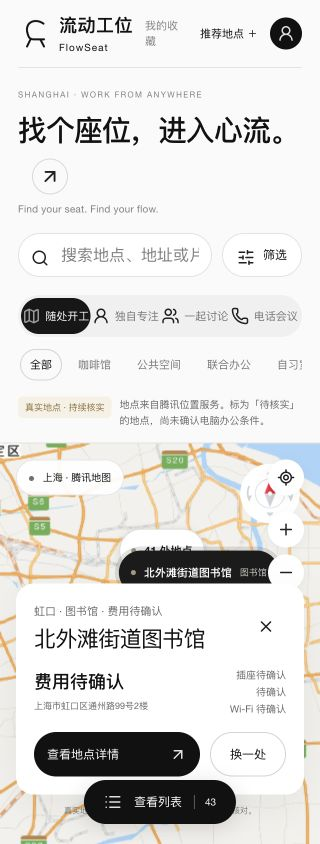
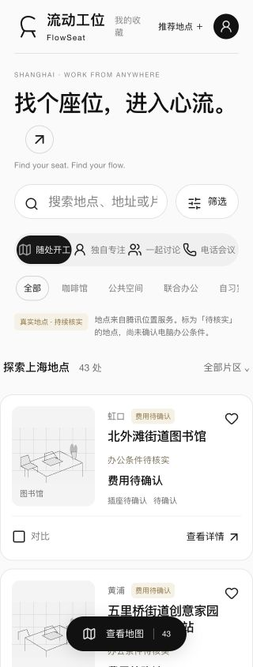
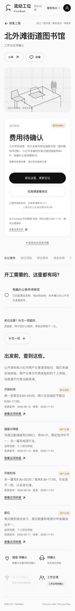
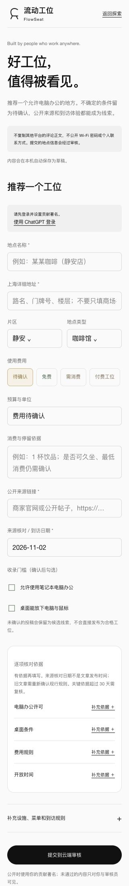

# 流动工位 · FlowSeat

**找个座位，进入心流。**  
Find your seat. Find your flow.

为自由职业者、远程工作者和独立创造者寻找适合带电脑工作的地方。上海起步，覆盖咖啡馆、公共空间、联合办公等地点：先在地图或列表里找，再看费用、开放时间、办公条件和信息来源，决定是否出发。

FlowSeat combines map-based workspace discovery with sourced place information and community contributions. Built with uni-app, Vue 3 and TypeScript, starting in Shanghai.

## 页面预览

以下为 **2026-11-02 功能版的本地浏览器截图**。截图中的数量为本地数据快照，不代表全部地点已经核实，也不代表实时余座；空间插画不是实景照片。

| 地图找位 | 地点列表 |
| --- | --- |
|  |  |

<details>
<summary><strong>查看地点详情与社区投稿页面</strong></summary>

| 地点详情 | 推荐一个工位 |
| --- | --- |
|  |  |

</details>

## 可以做什么

- **发现地点**：地图与列表切换，搜索地点或地址，按区域、类型及工作场景筛选；地图支持聚类及同坐标地点选择。
- **判断是否适合办公**：查看费用、开放时间、电脑使用规则、插座、Wi-Fi、桌椅及工作分区。没有可靠依据的字段保留“待确认”。
- **收藏与比较**：保存感兴趣的地点，对比办公条件；查看地点坐标并跳转导航。
- **共同维护信息**：推荐新地点、补充一项信息、到访核对、反馈空位或闭店；投稿与更正经审核后展示，保留贡献署名。
- **追溯信息来源**：区分官方资料、用户分享与商家自述，展示来源和日期。公开资料不等于实地体验，旧信息也不等于当前承诺。

## 当前状态

功能主线已实现上述页面与流程，Web 版本已部署到私有预览环境。**仓库公开不等于网站已向公众开放**；目前不提供免登录公开体验入口。

截至 2026-11-02，主线 80 项测试、发布源 45 项测试、客户端类型检查及 Web / 服务端构建通过，并完成桌面浏览器中的移动宽度检查。真实账号的完整审核闭环仍待验收；官方微信登录、小程序真机验收及实验视觉方案整合尚未完成。

当前 README 展示功能主线，`feat/flow-visual` 是单独保留的视觉试验，不作为正式发布效果。

## 技术与目录

| 目录 | 用途 |
| --- | --- |
| `apps/client` | uni-app + Vue 3 + TypeScript 客户端，Web 优先，保留小程序与 App 复用路径 |
| `site-preview` | Vinext API、Cloudflare D1、数据库迁移、客户端源码快照及 Web 产物 |
| `data` | 上海地点候选与带来源的研究资料 |
| `tests` | 功能与权限测试 |
| `docs` | 版本记录、开发说明及截图 |
| `miniprogram` / `cloudfunctions` | 早期微信原型，不是当前 Web 后端 |

腾讯地图提供地图与地点能力，审核身份由服务端校验。地图密钥、审核员配置和本地数据库不应提交到仓库。

## 本地开发

需要 Node.js 22.13+，分别安装根目录、客户端与服务端依赖：

```sh
git clone https://github.com/SiaBuilt/flowseat.git
cd flowseat
npm ci
npm --prefix apps/client ci
npm --prefix site-preview ci

# 类型检查与主线测试
npm run typecheck:client
npm test

# 构建客户端并同步到服务目录
npm run build:web
npm run sync:web
npm run build:server
```

启动前按 [服务端说明](site-preview/README.md) 配置本地环境并初始化 D1 迁移，然后运行：

```sh
npm --prefix site-preview run dev -- --port 4173 --hostname 127.0.0.1
```

服务端 `TENCENT_MAP_KEY` 用于地图能力，`REVIEWER_USER_IDS` 用于审核授权。真实值只放在被忽略的本地配置或部署平台环境变量中。生产登录依赖托管环境；本地身份模拟仅供 loopback 开发使用。

## 数据与贡献

欢迎通过 Issue 提交可复现的问题、地点线索或产品建议。地点信息请附公开来源和日期；请勿提交 Wi-Fi 密码、私人联系方式、账户凭证或未获授权的用户数据。未知字段保持未知，不以候选地点数量代替核实质量。

本仓库目前未单独授予项目级开源许可证；代码公开供浏览，复用需另行获得许可。第三方组件和素材遵循各自许可证。
